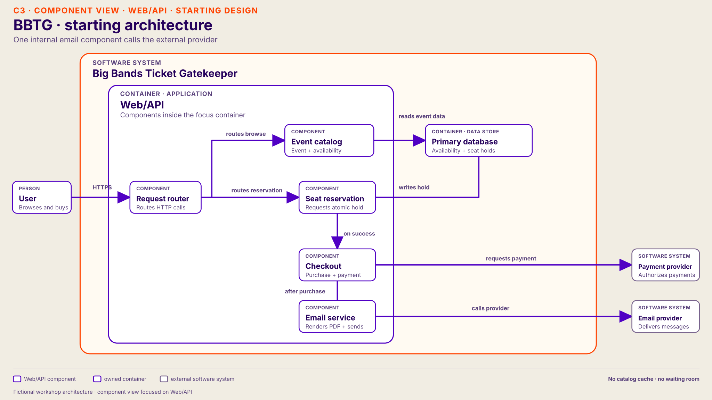

# Resource Scaling — host guide

The host acts like a dungeon master for one **fictional ticket-sale system**. Participants ask questions, diagnose pressure, change the architecture, and predict what happens next. Every group completes the quests in order and keeps its accepted changes. This exercise uses a recognizable Ticketmaster product scenario; it does **not** describe Ticketmaster's real architecture or operations.

## Ordered quest path

| Quest | New symptom | Preferred change | What it exposes next |
| --- | --- | --- | --- |
| [1. Slow event pages](quests/01-event-pages.md) | Event pages time out | Cache stable event details safely | More attempts reach seat reservation |
| [2. Hot seat reservations](quests/02-seat-reservations.md) | Purchase attempts wait | Gate admission before reservation | Completed purchases rise from 30 to 80/min; confirmations receive more work |
| [3. Confirmation backlog](quests/03-confirmation-backlog.md) | Emails arrive late | Increase independent workers | Render capacity rises from 40 to 120/min; more sends reach the provider |
| [4. Email provider limit](quests/04-email-provider.md) | Sends wait or retry | Bound outbound sends | Provider capacity remains 60/min against 80 arriving jobs/min |

Start every group with **Quest 1**. Timebox each quest to roughly 5–8 minutes, adjusting for discussion. At each transition, annotate the group's current drawing with its actual accepted change. The next quest starts from **that** architecture when its entry conditions hold.

## Starting architecture

**Users → Web/API → one primary database.** Checkout also calls a payment provider. There is no event-catalog cache or read replica at the start. A seat must never be sold twice; the primary database makes the authoritative reservation decision.

Share this diagram for [Quest 1](quests/01-event-pages.md) as a starting design, not a diagnosis. It zooms into the Web/API container and the synchronous purchase path. The primary database and payment provider sit outside that container. After a successful purchase, the system already puts a confirmation job on a durable queue for two workers; this asynchronous branch is outside the diagram's scope. Add it to the group's drawing at Quest 3, or earlier if participants ask about confirmation. Let participants annotate the original diagram rather than treating it as current after a change.

## Host rules

- Give symptoms before causes. Let participants ask about metrics, traces, workload, state, and dependencies. Answer equivalent questions with the same prepared fact; do not require exact wording.
- If a detail is not specified, say so and agree on a reasonable assumption. Never invent a new failure or revise an established fact merely to defeat a solution.
- Before applying a change, ask: “What do you expect to improve, what evidence would show that, and what might become the next limit?”
- Describe both benefit and trade-off. Multiple solutions can be defensible if they fit the evidence and protect that quest's stated invariant.
- Keep the scope architectural. Participants need a reasoned response, not a complete implementation or a particular platform.

## Run each quest

| Participants | Host |
| --- | --- |
| Hear a symptom and name possible causes. | Read only the participant brief; keep the cause hidden. |
| Ask about request timing, resource use, state, and dependencies. | Use the prepared answers. Give the fact they asked for, not the whole diagnosis. |
| Explain what creates the limit. | Confirm the explanation against the host-only cause; ask where state and ownership sit. |
| Propose a change and predict its effect. | Use the response menu. Ask what signal should improve and what might receive more load. |
| Compare the result with their prediction. | Reveal the consequence. Move to the next quest only when its stated conditions hold. |

The first column of both tables names the **component** participants ask about or propose changing. Look up that component, then read the question or proposal. The proposal text still distinguishes bigger, more instances, less work, and demand control. Each quest provides one concrete preferred change to help a host keep the exercise moving; another defensible proposal can work if it relieves the measured limit and preserves the invariant.

An asterisk beside the component and proposal marks the preferred host route for that quest.

Start each new quest with a short rebrief: **what changed in the architecture, which pressure signal improved, and why more work now reaches this path**. Check the new quest's entry condition before reading its participant brief. Quest 2 must show more successful purchases before Quest 3 receives more confirmation jobs; admission control alone does not guarantee that. Keep the current symptom if a proposal does not relieve its measured limit.

## Using the deck

Finish theory at slide 13, **Scaling is a toolbox**. Start Quest 1 on slide 14's traffic spike and share the starting architecture above. Slides 15–16 support priorities and workload questions; show slide 17's evolved design only after the group has investigated the catalog reads. Slide 18 supports Quest 2's overload choices. For Quests 3–4, return to slide 12's worker and queue patterns or keep the group's evolving diagram visible. Slides 19–21 support the final debrief. Keep quest answer banks off the projected screen.

For each quest, the group should be able to state the **symptom, hypothesis, evidence, proposed change, and predicted next limit**. If they stall, ask one nudge at a time: “Is the slow part doing work or waiting?”, “What evidence distinguishes those?”, then “Which work repeats, and which work changes shared state?”
