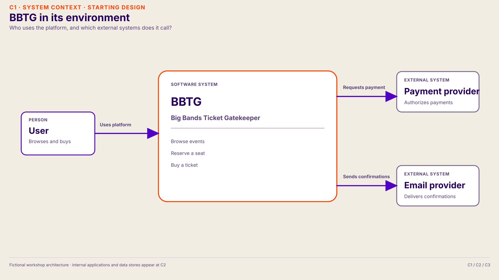
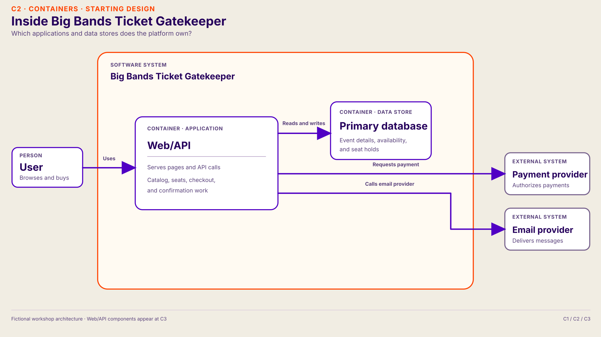

# Resource Scaling — host guide

The host acts like a dungeon master for **Big Bands Ticket Gatekeeper (BBTG)**, a fictional ticket platform. Participants ask questions, diagnose pressure, change the architecture, and predict what happens next. Every group completes the quests in order and keeps its accepted changes. The scenario uses a familiar concert ticketing flow; it does **not** describe Ticketmaster's real architecture or operations.

## Ordered quest path

| Quest | New symptom | Preferred change | What it exposes next |
| --- | --- | --- | --- |
| [1. Slow event pages](quests/01-event-pages.md) | Event pages time out | Cache stable event details safely | More attempts reach seat reservation |
| [2. Hot seat reservations](quests/02-seat-reservations.md) | Purchase attempts wait | Gate admission before reservation | Completed purchases rise from 30 to 80/min; confirmations receive more work |
| [3. Confirmation backlog](quests/03-confirmation-backlog.md) | Emails arrive late | Add a durable queue and independent workers | Render capacity rises from 40 to 120/min; confirmations catch up |
| [4. Seat inventory memory](quests/04-seat-inventory-memory.md) | Seat availability slows across nine shows | Increase primary database memory | Buffer churn and read waits fall if the hot set fits |

Start every group with **Quest 1**. Timebox each quest to roughly 5–8 minutes, adjusting for discussion. At each transition, annotate the group's current drawing with its actual accepted change. The next quest starts from **that** architecture when its entry conditions hold.

## Starting architecture

**Users → Web/API → one primary database.** The event page shows event details; “Choose seats” opens a separate live availability view. Checkout also calls a payment provider. Below Checkout, one internal Email service component renders confirmations and calls the external Email provider. It runs background work after purchase with two rendering slots; there is no separate durable queue or worker application yet. There is no event-catalog cache, read replica, or waiting room at the start. A seat must never be sold twice; the primary database makes the authoritative reservation decision.

### C1 — system context

Show on slide 15. This [system context diagram](https://c4model.com/diagrams/system-context) shows the User, BBTG, and external providers without internal implementation details.

### C2 — containers

Show on slide 16. In C4, a [container](https://c4model.com/diagrams/container) is an application or data store. The Web/API application and primary database are inside BBTG's boundary. There is no independent cache, queue, waiting room, or confirmation worker at the start.

### C3 — Web/API components

Show on slide 17 and share for [Quest 1](quests/01-event-pages.md) as a starting design, not a diagnosis. Read from the User on the left through Web/API, then follow Checkout down to Email service and right to the external Email provider. Keep that path visible but focus the first investigation on slow event pages. Let participants annotate this diagram as they accept changes.

In C4, a [component diagram](https://c4model.com/diagrams/component) has one container in scope and may show connected containers and external software systems. The Email service is one component within Web/API. Quest 3 adds a durable queue and a confirmation worker [application container](https://c4model.com/abstractions/container); its six running instances are an exercise annotation. A formal [deployment diagram](https://c4model.com/diagrams/deployment) would show the instances separately. Technology choices remain open in this fictional exercise.

## Updated diagrams

Each quest includes a diagram of the **preferred** architecture after its change. Show one only after the group has confirmed that change. If participants chose another valid response, keep their actual architecture on the drawing.

| Handoff | Diagram | Change shown |
| --- | --- | --- |
| After Quest 1 | [Catalog cache](ticket-on-sale-after-quest-1.svg) | Stable event details use a shared cache; Email service still calls the provider directly. |
| After Quest 2 | [Reservation gate](ticket-on-sale-after-quest-2.svg) | The cache remains; a waiting room admits attempts without holding seats. Email service still calls the provider directly. |
| After Quest 3 | [Queue and worker](ticket-on-sale-after-quest-3.svg) | Earlier changes remain; Email service enqueues work for a new worker application with six instances. |
| After Quest 4 | [Larger database memory](ticket-on-sale-after-quest-4.svg) | Earlier changes remain; the primary database has a larger buffer pool for active seat pages. |

## Host rules

- Give symptoms before causes. Let participants ask about metrics, traces, workload, state, and dependencies. Answer equivalent questions with the same prepared fact; do not require exact wording.
- If a detail is not specified, say so and agree on a reasonable assumption. Never invent a new failure or revise an established fact merely to defeat a solution.
- Before applying a change, ask: “What do you expect to improve, what evidence would show that, and what might become the next limit?”
- Describe both benefit and trade-off. Multiple solutions can be defensible if they fit the evidence and protect that quest's stated invariant.
- Keep the scope architectural. Participants need a reasoned response, not a complete implementation or a particular platform.

## Run each quest

| Participants | Host |
| --- | --- |
| Hear a symptom and name possible causes. | Read only the participant brief; keep the cause hidden. |
| Ask about request timing, resource use, state, and dependencies. | Use the prepared answers. Give the fact they asked for, not the whole diagnosis. |
| Explain what creates the limit. | Confirm the explanation against the host-only cause; ask where state and ownership sit. |
| Propose a change and predict its effect. | Use the response menu. Ask what signal should improve and what might receive more load. |
| Compare the result with their prediction. | Reveal the consequence. Move to the next quest only when its stated conditions hold. |

The first column of both tables names the **component** participants ask about or propose changing. Look up that component, then read the question or proposal. The proposal text still distinguishes bigger, more instances, less work, and demand control. Each quest provides one concrete preferred change to help a host keep the exercise moving; another defensible proposal can work if it relieves the measured limit and preserves the invariant.

An asterisk beside the component and proposal marks the preferred host route for that quest.

Start each new quest with a short rebrief: **what changed in the architecture or workload, which pressure signal improved, and why this path needs investigation**. Check the new quest's entry condition before reading its participant brief. Quest 2 must show more successful purchases before Quest 3 receives more confirmation jobs; admission control alone does not guarantee that. Quest 4 introduces nine simultaneous shows after confirmations have caught up, rather than claiming Quest 3 caused database pressure. Keep the current symptom if a proposal does not relieve its measured limit.

## Using the deck

Finish theory at slide 13, **Scaling is a toolbox**. Slide 14 introduces BBTG. Use slides 15–17 to zoom from C1 context to C2 containers and C3 Web/API components. Show slide 18's participant question board while reading the Quest 1 brief, then leave it visible through the quests. The cards are prompts to use in any order, not answers. Bring back slide 17 or a shared C3 diagram when the group needs to trace a path; return to slide 18 afterward. Reveal the matching updated host diagram after each quest when its preferred change fits the group's result. For Quest 3, shift attention to the confirmation path already visible in the diagram. For Quest 4, announce the new nine-show workload and return to the live seat path; slide 10's database patterns may help. Show slide 19's takeaway after the final quest. Keep quest answer banks off the projected screen.

For each quest, the group should be able to state the **symptom, hypothesis, evidence, proposed change, and predicted next limit**. If they stall, ask one nudge at a time: “Is the slow part doing work or waiting?”, “What evidence distinguishes those?”, then “Which work repeats, and which work changes shared state?”
