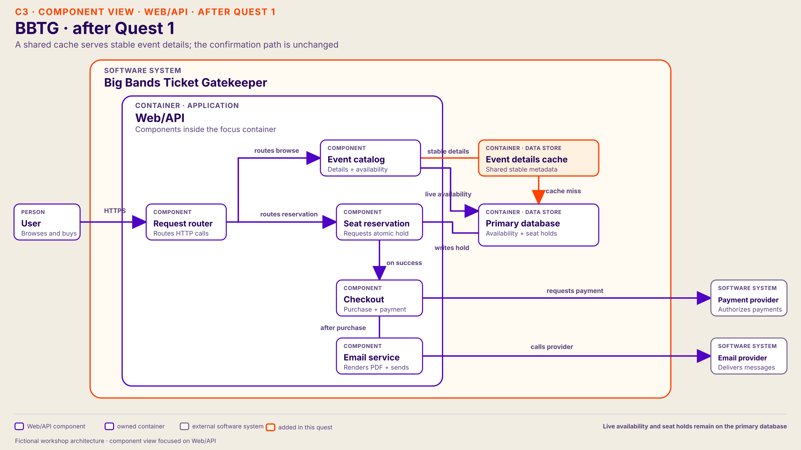

# Quest 1 — slow event pages

Big Bands Ticket Gatekeeper is a fictional ticket platform, not Ticketmaster’s production architecture. Start from the [host’s starting architecture](../README.md#starting-architecture) and keep every accepted change on the group’s drawing.

In the proposal table, `*` marks the preferred host route.

## Participant brief

Read aloud with slide 18's participant question board visible, after introducing the platform on slide 14 and its C1–C3 starting architecture on slides 15–17:

> A major artist's Ziggo Dome tickets went on sale at 12:00. At 12:01, event pages are slow and some requests time out. Users still need to browse, reserve, and purchase. What would you like to inspect?

## Host-only cause

Many users request the same event page. Every request repeats reads of the same **stable event details**, which dominate the measured catalog read load. Live seat availability is a separate read and must remain accurate at reservation. Database read I/O and connection waiting now limit completed page requests. API CPU has headroom. Reservation writes and payment are not the current limit.

## Questions participants may ask

Give the observation first. Let participants ask for evidence before naming the cause.

| Component | Participant question | Host answer |
| --- | --- | --- |
| Event catalog | Are event pages the slow path after 12:00? | Event pages slow and time out. Many users browse the same event; checkout traffic is smaller. |
| Event catalog | Where does a slow event-page request spend its time? | Most time is database waiting, not API computation or payment. |
| Event catalog | What work creates the repeated read pressure? | Every page request rereads the same stable event details, such as name, venue, and date, from the primary database. No result is reused; live seat availability is a separate read. |
| Web/API | Is the API out of CPU or memory? | Both have headroom. Slow requests spend much of their time waiting. |
| Primary database | What do database metrics show? | Read I/O and connection waits are high; reservation writes are not the current limit. |
| Payment provider | Is payment slow? | Payment is healthy and is not on the event-page path. |
| Seat reservation | Can Seat Reservation use a cache to promise a seat? | Stable catalog details can tolerate brief staleness. Only the primary database can authoritatively reserve a seat. No cache or read replica exists initially. |

## Responses to proposals

| Component | Participant proposal | Host response in this quest |
| --- | --- | --- |
| Web/API | Make the API bigger (vertical) | API CPU and memory have headroom, so a larger API does not reduce the database wait. Stay in Quest 1. |
| Web/API | Add API replicas (horizontal) | Independent requests can reach the same overloaded database faster. This may increase its pressure; stay in Quest 1. |
| Web/API | Bound incoming catalog reads | A gate can protect the database by admitting fewer reads, but users wait. Read capacity has not increased. |
| **Event catalog**\* | **Cache event details**\* | Can reduce repeated metadata reads if misses are controlled and live seat decisions remain authoritative. Use the preferred change below. |
| Primary database | Make the database bigger (vertical) | May buy read I/O or connection headroom if the measured limit improves. It still performs repeated reads. |
| Primary database | Add a read replica | Route suitable catalog reads to a replica if its lag is acceptable. Reservation writes stay with the primary owner. |
| Primary database | Improve queries or indexes | Reduce scanned rows or fetched data if query evidence supports it. Advance only when read waits actually fall. |
| Primary database | Partition writes | This addresses a different path; catalog reads are the measured limit now. Stay in Quest 1. |

## Preferred host change — cache stable event details

If someone says “cache the event page,” pause and cover four points:

| Cue | Host talking point |
| --- | --- |
| **Why** | Every page rereads the same stable facts; database reads and waits limit responses while API CPU has headroom. |
| **What** | Cache the event name and artist, venue, date and time, and static description in a shared Event Catalog cache keyed by event ID. Live seat availability and authoritative holds stay on the primary-database path. |
| **How** | Coalesce cold misses, expire or invalidate changed details, and bound database fallback if the cache fails. |
| **Proof** | Cache hits rise; database read waits and page latency fall. If they do not, stay in Quest 1. |

## Architecture after Quest 1

Show this diagram after the group confirms the preferred cache change. Stable event details use the shared cache; live availability and seat holds still use the primary database. If the group chose another valid change, keep its actual design on the drawing instead.

