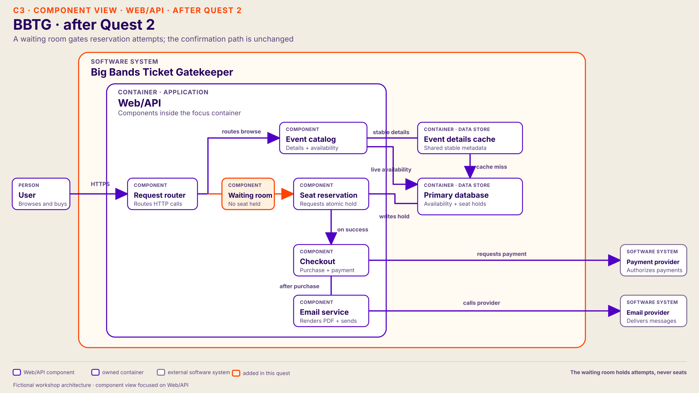

# Quest 2 — hot seat reservations

Continue the same fictional system and the architecture participants left after [Quest 1](01-event-pages.md). Keep their accepted catalog-read change in place.

In the proposal table, `*` marks the preferred host route.

## From Quest 1

Start only when Quest 1's accepted change lowers database read waits and event-page latency. Keep the group's actual change—cache, query improvement, read replica, or larger database—on the drawing. If those signals have not improved, stay in Quest 1.

Briefly re-establish the result: their Quest 1 solution **worked for the problem it addressed**. Faster pages let more users reach the purchase path. Then read the new symptom without naming its cause.

## Participant brief

> Your change worked: event pages now respond faster. More users reach the purchase path, but users report a new problem. Purchase attempts slow down, especially when many users choose the same seats. Some users wait; others receive “unavailable.” Where would you look next?

## Host-only cause

Many attempts collide on a small set of popular seats while other seats remain available. Waiting and repeated retries occupy the reservation path's limited database connections, so attempts for other available seats also wait. This avoidable contention holds completed purchases to **30 per minute** in this fictional exercise. Browse read pressure has fallen because of the group's earlier change; request-handling CPU and payment have headroom. The Email service's two background rendering slots could handle 40 confirmations per minute, so they are not limiting yet. Correctness still holds: no seat is sold twice.

Here the bottleneck moves **within the same primary database**: catalog-read pressure falls, then contended reservation writes limit completed purchases. A later bottleneck can also appear in another component. The point is that relieving one constraint exposes whichever constraint limits the newly flowing work.

## Questions participants may ask

| Component | Participant question | Host answer |
| --- | --- | --- |
| Checkout | Is checkout slower now? | Event pages have improved. Purchase attempts for popular seats wait or return “unavailable.” No seat is double-sold. |
| Checkout | Where does a checkout trace spend its time? | At the inventory/reservation write, before payment. |
| Checkout | How many purchases actually finish? | About 30 per minute despite many more attempts; lock waits and retries consume the write path. |
| Web/API | Are API CPU or memory saturated? | They have headroom. More API replicas can admit more contenders but cannot create seats. |
| Primary database | What do database metrics show? | Catalog read pressure is lower; write/lock waits cluster on popular seats, and waiting transactions occupy reservation connections. |
| Payment provider | Is payment slow or rate-limited? | The provider is healthy at this point and is not causing the current wait. |
| Seat reservation | What creates Seat Reservation's write wait? | Multiple attempts compete for the same seats. Their waits and retries occupy connections that could serve attempts for other seats. The primary database coordinates the authoritative decision. |
| Seat reservation | Who owns a seat? Can a queue or cache promise one? | The primary database owns the decision. A waiting room admits attempts; a cached page or queued request cannot guarantee a seat or justify immediate confirmation. |

## Responses to proposals

| Component | Participant proposal | Host response in this quest |
| --- | --- | --- |
| Web/API | Make the API bigger (vertical) | API resources have headroom. A larger API does not shorten reservation write waits. |
| Web/API | Add API replicas (horizontal) | More attempts reach the same contended write path; the current limit stays. |
| Primary database | Make the database bigger (vertical) | May help a separately measured node limit. It does not remove competition for one seat by itself. |
| Primary database | Add a read replica | May help browsing, but the authoritative reservation write still has one owner. |
| Seat reservation | Shorten the reservation transaction | Consider if a trace shows avoidable work inside the transaction. The supplied evidence points to contention. |
| **Admission gate**\* | **Add a waiting room**\* | Hold excess attempts outside the reservation path, admit a bounded number, and keep attempts for one hot seat from occupying every slot. This can reduce wasted waits; check completed purchases. |
| Checkout | Defer notifications | The Email service already starts confirmation after purchase. Delaying it further does not shorten reservation write waits. |

## Preferred host change — gate reservation attempts

Once participants locate the wait at the seat-reservation write, explain how the waiting room works **in this exercise**:

1. A user chooses a seat and enters that event's waiting room. Their place in line **does not hold the seat**. Browsing remains available.
2. The gate admits a limited number of reservation attempts at once. It allows at most one active attempt for a given seat and admits attempts for other seats while contenders wait **without holding a reservation database connection**. Tune the limit using completed purchases, connection waits, and lock waits.
3. Seat Reservation asks the primary database to make the **atomic** decision. A successful attempt continues to checkout; if the seat is unavailable, the user must choose another. The gate never promises a seat.
4. Release the admission slot on success, failure, or timeout. A retry goes back through the gate with a delay, rather than repeatedly hitting the database.

Host phrasing: “The waiting room holds attempts, not seats. It keeps hot-seat retries out of database connections so purchases for other available seats can finish.” The increase from 30 to 80 per minute is a **scripted exercise outcome**, not a general property of waiting rooms.

Then cover four points:

| Cue | Host talking point |
| --- | --- |
| **Why** | Attempts for popular seats wait and retry while holding scarce reservation connections. Other seats are available, but their buyers wait too; only 30 purchases finish per minute. |
| **What** | Add a per-event waiting room before Seat Reservation. Browsing keeps the group's Quest 1 read-path change; the primary database still owns the authoritative seat decision. |
| **How** | Bound active attempts, allow only one active attempt per seat, admit other seat choices fairly, and pace retries. The primary database still makes the final seat decision. |
| **Proof** | In this fictional run, fewer waits and retries free connections for purchases of other available seats, and completed purchases rise from **30 to 80 per minute** without double-selling. This is a scripted result, not a promise of a waiting room. Track waiting-room age; if completions do not rise, stay in Quest 2. |

## Architecture after Quest 2

Show this diagram when the preferred waiting-room change reduces reservation waits and raises completed purchases. It carries forward the Quest 1 cache. The waiting room holds attempts, while the primary database still makes each seat decision. If the group chose a different valid route, keep its actual design on the drawing.

