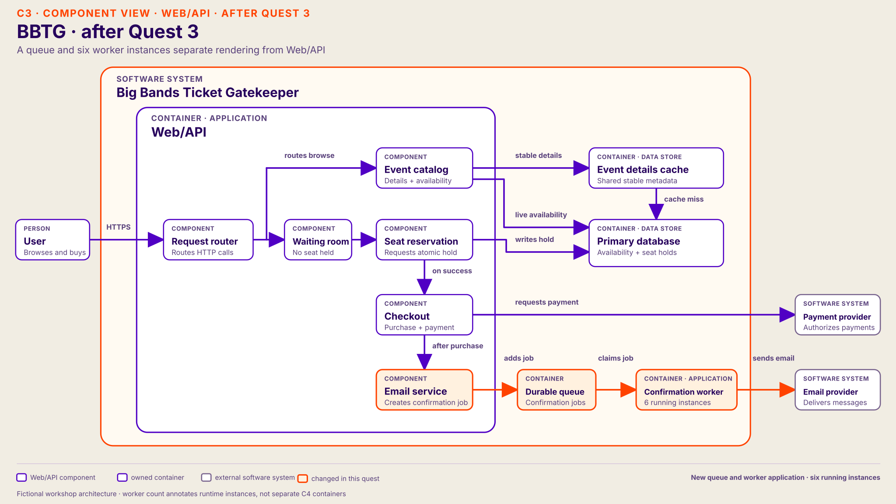

# Quest 3 — confirmation backlog

Continue the same fictional system and the architecture participants left after [Quest 2](02-seat-reservations.md). Keep their catalog-read and reservation changes in place.

In the proposal table, `*` marks the preferred host route.

## From Quest 2

Start only when Quest 2's accepted change reduces lock waits without double-selling and **raises completed purchases**. Keep that change on the drawing. The preferred waiting room raises completions from 30 to **80 per minute**; use the group's measured result for another valid solution. Rebrief: “Your reservation fix worked. More purchases finish, and each one asks the Email service to prepare a confirmation.”

The Email service has been visible below Checkout since the starting diagram. Shift attention to it before reading the new symptom:

```text
Checkout → Email service → external Email provider
           (render PDF, then send)
```

The Email service runs this work after purchase in two background rendering slots inside Web/API; the purchase response does not wait for delivery. Pending work is held in the application, without a separate durable queue. Do not reveal which part of this branch is limiting until participants investigate.

## Participant brief

> Your reservation change worked: more purchases finish, and seats are still sold correctly. Checkout shows an order number right away. Each confirmation email includes a personalized PDF ticket, but those emails now arrive increasingly late. Pending confirmations keep growing. What would you like to inspect?

## Host-only cause

Rendering each PDF consumes substantial CPU. Use these **fictional exercise rates** when participants ask for numbers: 80 confirmations arrive per minute after Quest 2; each of the Email service's two background slots can render 20 PDFs per minute. The Email service can render only 40 PDFs per minute, so its rendering CPU is the limit. In this quest, the external Email provider has enough headroom for the worker throughput achieved by an accepted change. Purchase requests and the primary database are healthy.

## Questions participants may ask

| Component | Participant question | Host answer |
| --- | --- | --- |
| Web/API | Are purchases slow too? | Purchases complete normally. The response does not wait for confirmation; rendering uses a separate background CPU allocation. |
| Primary database | Is the primary database slow? | The purchase path and its database are healthy. |
| Email service | How many confirmations arrive and finish? | 80 arrive per minute; the two background slots render 40 per minute. Pending work and its oldest age grow in the application. |
| Email service | Is rendering CPU or memory saturated? | The allocated rendering CPU is saturated; memory has headroom for now. Each slot renders 20 PDFs per minute. |
| Email service | What work creates the CPU limit? | Rendering a personalized PDF dominates each confirmation. The two slots cannot keep up with new purchases. |
| Email service | Can confirmations run independently? What happens on restart? | Different purchase IDs can be processed independently. In-process pending work is not durable; a restart can lose it. |
| Email provider | Is the email provider already rate-limiting? | No. It accepts about 40 sends per minute now and has headroom for the worker throughput after an accepted change. |

## Responses to proposals

| Component | Participant proposal | Host response in this quest |
| --- | --- | --- |
| Web/API | Make the API bigger (vertical) | More CPU could help the Email service render faster if that allocation grows. Measure the new completion rate; pending work remains tied to the application. |
| Web/API | Add API replicas (horizontal) | More replicas could add rendering slots if work is distributed safely. In-process pending work remains vulnerable to restarts and needs clear ownership. |
| Web/API | Limit new purchase intake | Fewer admitted confirmations can stabilize the backlog, with a product trade-off. |
| Email service | Add only a durable queue | This preserves pending work but does not raise rendering capacity. Oldest-job age still grows at 80 arrivals and 40 completions per minute. |
| **Email service**\* | **Move work to a durable queue and independent workers**\* | Run six worker instances with safe claims and retries. Potential rendering capacity rises from 40 to 120 PDFs/minute. |
| Email service | Make PDF rendering cheaper | Optimize or simplify rendering if measured CPU cost falls. Recalculate total render capacity. |
| Email service | Partition confirmations | Purchase IDs are independent. Partitioning can help ownership but adds no rendering capacity by itself. |

## Preferred host change — queue and independent workers

Once participants identify PDF rendering as the CPU-heavy step, cover four points:

| Cue | Host talking point |
| --- | --- |
| **Why** | 80 confirmations arrive per minute, but the Email service's two CPU-bound slots render only 40 PDFs per minute. Pending work grows in application memory. |
| **What** | Have the Email service enqueue a job after purchase. Add a durable queue and a separate confirmation worker application with six running instances. Keep the earlier read-path and reservation changes. |
| **How** | Have one worker claim each job. Recognize retries by purchase ID and keep a durable send record; use provider idempotency keys if supported. The queue alone does not guarantee exactly-once sends. |
| **Proof** | Six workers can potentially render **120 PDFs per minute** at 20 each, above 80 arrivals. With the provider healthy at the achieved rate, completed sends can catch up and oldest-job age should fall. Verify both before moving on; a queue or extra workers alone do not prove delivery. |

## Architecture after Quest 3

Show this diagram after the preferred change raises rendering capacity. It keeps the cache and waiting room. The Email service now enqueues confirmation jobs; a new durable queue feeds a new worker application with six running instances, which calls the same external Email provider. If the group used another valid change, update its own drawing instead.


