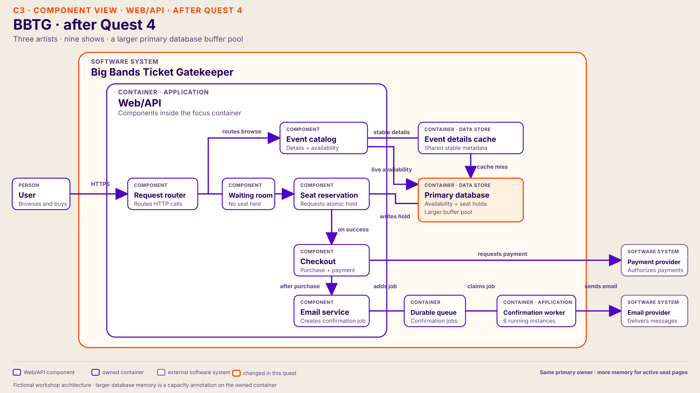

# Quest 4 — active seat inventory exceeds database memory

Continue the same fictional system and the architecture participants left after [Quest 3](03-confirmation-backlog.md). Keep their accepted catalog, reservation, and confirmation changes in place. This quest introduces a new workload; Quest 3 does not cause this limit.

In the proposal table, `*` marks the preferred host route.

## From Quest 3

Start only when Quest 3's accepted change lets confirmations complete at least as fast as they arrive and oldest-job age falls. The preferred six-worker application has potential PDF rendering capacity of **120 per minute** against **80 arrivals per minute**; the external Email provider has headroom at this exercise rate. Keep the group's actual change on the drawing.

Rebrief: “Your confirmation change worked. Emails are arriving on time.” Then introduce a later on-sale: **three artists, three shows each**, with all nine shows opening together. The added active seat inventories are a new workload condition, not a hidden consequence of the worker change.

## Participant brief

> Later that day, three artists each open three shows for sale at the same time. Event pages still load quickly, but live seat availability updates lag. The waiting room admits users as planned; even admitted reservation attempts take longer and some time out. Successful purchases are correct, and confirmation emails arrive on time. What would you inspect?

## Host-only cause

On the preferred path, the Quest 1 cache serves stable event details, not live seat availability; another accepted Quest 1 fix likewise keeps event details fast. Live availability reads and authoritative seat holds still reach the primary database. Across nine active shows, the **measured hot seat and index pages exceed the database buffer pool**. Frequently reused pages are evicted and read back from storage; physical reads and storage wait rise. The group's Quest 2 change still controls contention, so lock waits remain low and no seat is double-sold. Web/API CPU, payment, and the confirmation path have headroom.

The preferred vertical change is a larger-memory primary database instance **with its buffer pool sized to use that memory**. The number of shows sets up a larger working set; it does not by itself prove that memory is the limit. Give participants the buffer and I/O evidence only when they ask.

## Questions participants may ask

| Component | Participant question | Host answer |
| --- | --- | --- |
| Event catalog | Are event details slow again? | No. Stable details remain fast; they hit the shared cache on the preferred path. Live seat availability is the slow part and still reads the primary database. |
| Waiting room (preferred path) | Is the gate admitting too many attempts or holding seats? | It admits a bounded number and holds no seats. Admitted attempts still wait; making the gate stricter would move the wait to the queue. |
| Seat reservation | Are hot-seat locks or double-selling back? | No. Lock waits remain low, and the primary database still makes each atomic seat decision. |
| Web/API | Is application CPU saturated? | No. Requests spend most of their new time waiting on primary-database reads. |
| Primary database | What changed with nine shows? | More distinct live seat and index pages are active at once. The measured hot set exceeds the current buffer pool. |
| Primary database | What do memory and I/O metrics show? | Hot-page evictions, physical reads, and storage read wait rise. Database CPU has headroom; lock waits remain low. |
| Confirmation path | Are confirmations backing up again? | No. Jobs complete at least as fast as they arrive, and the external Email provider is healthy. |

## Responses to proposals

| Component | Participant proposal | Host response in this quest |
| --- | --- | --- |
| Web/API | Make the API bigger or add replicas | The application is waiting on database reads. More API capacity does not keep seat pages in database memory and may add pressure. |
| Event catalog | Cache live availability | A short-lived browse hint could reduce some reads if staleness is acceptable. It cannot promise a seat or replace the authoritative reservation check. |
| Waiting room | Admit fewer attempts | This can protect the database, but users wait longer and the measured memory capacity does not grow. |
| Primary database | Add CPU | CPU has headroom; the measured delay is storage read wait. |
| **Primary database**\* | **Increase database memory (vertical)**\* | Move to a larger-memory instance and size the buffer pool for the measured hot set plus headroom. Verify that evictions and read waits fall. |
| Primary database | Improve queries or indexes | Valid if traces reveal avoidable scans or excess fetched data. In this exercise, indexed lookups still reread evicted hot pages. |
| Primary database | Add a read replica | May offload suitable browse reads if lag is acceptable. Authoritative holds remain on the primary and must not rely on stale availability. |

## Preferred host change — give the primary database more memory

Once participants connect the slow path to buffer-pool churn, cover four points:

| Cue | Host talking point |
| --- | --- |
| **Why** | The active seat and index pages across nine shows exceed the database buffer pool. Repeated storage reads slow live availability and admitted reservations. |
| **What** | Scale the primary database vertically to a larger-memory instance. Keep the same authoritative seat owner and the group's accepted catalog, reservation, and confirmation changes. |
| **How** | Size the buffer pool from the measured hot working set with headroom; increasing installed RAM without adjusting the database memory allocation may not help. Check efficient indexes and query plans before attributing every read to memory size. |
| **Proof** | Buffer evictions and physical read wait fall; live-availability and admitted-reservation latency improve without double-selling. If they do not, revisit the hypothesis. A larger instance costs more and still has a ceiling. |

## Architecture after Quest 4

Show this diagram after the preferred change improves the measured read waits. The primary database is the same owned container with a larger memory tier and buffer pool; all earlier architecture changes remain. If the group chose another valid route, update its own drawing instead.

## Finish the path

Ask the group to explain why **nine shows** were a workload clue rather than a diagnosis, and why the low lock-wait and high physical-read evidence supported memory capacity. Compare Quest 3's extra worker instances with Quest 4's larger database instance. End when participants can name the signal they expect to improve, the correctness rule that remains, and one limit the larger instance would not remove.
